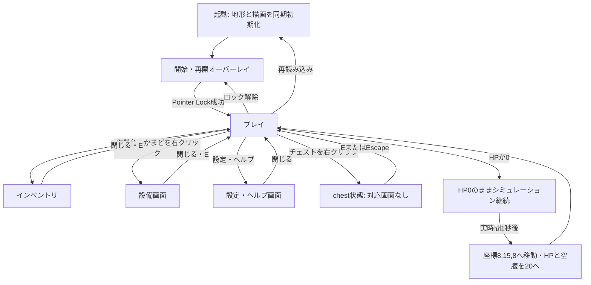

# NineCrafts ゲームレビュー

レビュー日: 2026-10-21（日本時間） / 対象: ローカル全リポジトリ、コミット `bf04bd2127ff5e404b5cf215cf14d60b15451b3e`。
開始時のローカル差分は未追跡の `bun.lock` のみ。既存ソース・設定・ロックファイルは変更していない。

## 1. 概要

**リリース可否: 不可。Critical 3件、High 14件。** PC・スマホ両対応のオープンワールドゲームとして必要な入力と進行保存が成立していない。
ビルドは通るが、満杯時のアイテム消失、素材なしクラフト、精錬での複製、採掘条件の無視により、資源を集めて成長する仕組みが壊れている。
水の拡散制限、爆発時の描画更新、チャンクの保持、GPU資源の解放にも具体的な欠陥がある。60分の探索を支える実装とは評価できない。
ゲーム性・操作感・UI/UXの評価は、**コード上の数値・ロジック・フローから読み取れる範囲の評価**。実機プレイやFPS計測の結果ではない。

## 2. 前提・構成

### 技術構成

| 項目 | 確認結果・根拠 |
|---|---|
| フレームワーク | Next.jsではない。Vite SPA。`package.json:8` の `"build": "vite build"`、`src/main.tsx:5` の `createRoot(document.getElementById('root')!).render(<App />);`。Next設定・Router・SSR・Server Component・Hydrationは対象外。 |
| バージョン | 宣言: React `^19.0.1`、Three.js `^0.170.0`、Vite `^8.3.0`（`package.json:21`〜24）。ローカル導入版: React/React DOM 19.3.0、Three.js 0.170.0、Vite 8.3.1、TypeScript 7.0.2、Tailwind CSS 4.3.3。導入版はnode_modules内のpackage.jsonで確認。 |
| 状態管理 | HUD・インベントリ・設定は `useState`（`src/App.tsx:42`以降）、Three.js・物理状態は `threeRefs`（同:130）。外部ストアなし。 |
| 描画 | Three.js WebGLRenderer、PCFソフトシャドウ、ACES、DPR上限1.25（`src/App.tsx:199`〜205）。25種類のブロック用InstancedMesh、各40,000枠（`src/world.ts:8`、:335〜347）。箱単位の隠蔽判定で、面単位の結合ではない。 |
| ループ | rAF + THREE.Clock、delta上限0.08秒。Pointer Lock中だけupdateGame、描画自体は常時実行（`src/App.tsx:280`〜289）。固定ステップなし。 |
| 入力 | PointerLockControls、WASD・Space・Shift・F・数字キー・マウス。タッチ移動／視点操作・ゲームパッドなし（`src/App.tsx:644`〜773、:775〜998）。 |
| 音声 | Web Audio合成。ユーザー操作でAudioContext開始（`src/audio.ts:11`〜25）、BGMはsetTimeout（同:483〜529）。SE/BGMのON/OFFはあるが個別音量UIなし（`src/App.tsx:1968`〜1987）。 |
| アセット | Canvasで16pxテクスチャを同期生成しCanvasTexture/data URLへ変換（`src/textures.ts:4`〜8、:518〜526）。音声ファイルのダウンロードなし。Google Fontsのみ外部参照（`index.html:12`〜14）。 |
| ワールド | 16×16チャンク。地形・洞窟は座標の三角関数、鉱石・植生はMath.random（`src/world.ts:363`〜398、:430〜475）。保存可能なシードはない。 |
| セーブ | ブロックのexport/importメソッドだけ存在（`src/world.ts:858`、:870）。呼び出し・永続化・ロードUIなし。version:1は出力されるが入力時の検証なし。R02参照。 |
| 検査設定 | `lint`はtscだけ（`package.json:11`）。ESLint設定、testスクリプト、既存テストなし。tsconfigにstrict指定なし。R25参照。 |

### 再構成した状態遷移



根拠: `src/App.tsx:213`〜220（lock/unlock）、:646〜666（E/Escape）、:921〜945（設備）、:382〜393（復活）、:1338（開始条件）。設備や設定中は物理ループが止まる一方、かまどのsetInterval・TNTのsetTimeout・復活タイマーは別時計で進む。明示的な「死亡」「ゲームオーバー」「リトライ」「タイトルへ戻る」状態はない。チェストは永久詰みではなくE/Escapeで脱出できる。

### 評価の前提と適用範囲

PC 60fps・ミドルレンジスマホ30fps以上、約60分、カジュアル層は依頼文の**仮の評価基準**として扱う（例示のため正式な仕様確定とはみなさない）。実測目標達成は判定できない。
全アプリ実装（srcの10モジュール＋CSS）、HTML、Vite/TypeScript設定、依存宣言、ローカルbun.lock、環境変数例、メタデータを確認した。依存ライブラリ全ソースの監査ではない。

## 3. 自動検証の結果

| 検証 | 実行・結果 | 留意点 |
|---|---|---|
| 型チェック | `npx --no-install tsc --noEmit` 成功、exit 0 | ローカルtscを使用。依存の自動追加を避けるためno-installを付与。 |
| Lint | `npm run lint` 成功、exit 0 | 実体は同じtsc。Hooksの依存配列やアクセシビリティをESLintで検査したわけではない。 |
| プロジェクトのテスト | **未実施** | testスクリプト・既存テストなし。 |
| Nextビルド | **対象外・未実施** | Next.js依存も設定もない。nextを導入しての検証はしていない。 |
| 本番ビルド | `npm run build -- --outDir /private/tmp/ninecrafts-review-build-20261021` 成功、exit 0 | 1669モジュール。リポジトリ内へdistを作らず一時領域へ出力。 |
| 依存監査 | `npm audit --package-lock-only --ignore-scripts --cache /private/tmp/ninecrafts-review-npm-cache` 実行失敗 | ENOLOCK。npm用lockがない。既存のbun.lockはnpm auditの対象にならない。脆弱性の有無は**未確認**。lock作成や依存更新はしていない。 |
| 補助ロジック検証 | Node + 既存tsxで標準入力のスクリプトを実行、exit 0 | 下表。プロジェクトテスト追加・ブラウザプレイではない。 |

ビルド出力: HTML 1.54kB（gzip 0.67kB）、CSS 35.73kB（6.90kB）、JS **837.47kB（222.64kB）**。JSは単一チャンクで500kB超の警告あり。SPAのためNextのページ別JSサイズは対象外。
警告はほかに、将来のnative config loaderに非対応の `__dirname`（`vite.config.ts:11`）と、一時出力先がプロジェクト外で自動消去されない通知。ビルド成功をWebGLシェーダーや実機FPSの成功と読み替えていない。

| 補助検証 | 条件と観測結果 |
|---|---|
| 水 | VoxelWorldの実メソッドを使用。描画更新をカウンターに置換。水1個をy=-13へ配置し0.35秒×100回更新。871ブロック、水平マンハッタン距離21、待ち164件。想定のspread<3に収まらない（R07）。 |
| 爆発 | -4〜4の石の立方体、半径4、Math.random=0.5。257ブロック破壊でupdateInstancedMeshesが257回。描画・粒子はスタブなので所要時間/FPSは測っていない（R08）。 |
| 負座標 | x=-1,y=1,z=0に追加して、隣のchunk(0,0)がdirtyにならない（R18）。 |
| 敵出現 | spawnMobを型の記録へ置換、乱数0、昼100回→夜100回。26匹すべて動物、敵0（R12）。 |
| 敵速度 | 衝突なしの追跡更新式を10秒反復。30/60/144fpsで定常速度7.111/3.556/1.481ブロック毎秒（R11）。画面計測ではない。 |
| 近接攻撃 | MobManager実update、床のgetBlockだけスタブ。ゾンビ／クモの足y=1、プレイヤー視点y=2.62、XZ一致、夜、1/60秒×600回。各10秒間の被弾0（R17）。 |
| レシピ | 全24レシピの定義パターンをmatchRecipeへ渡し、24件とも自分のレシピと一致。素材消費やUIを検証した結果ではない。 |

## 4. 観点別スコア表

5=十分、4=軽い問題、3=制約付き、2=重大な欠陥、1=中核要件未達。実機未計測のため動作性はコード構造による暫定評価。

| 観点 | 評価 | 根拠 |
|---|---|---|
| 動作性 | 2/5 | DPR制限・インスタンシングはあるが、水・爆発・長距離探索・資源解放に欠陥（R07〜R10）。 |
| 安定性 | 1/5 | 永続保存なし、満杯時の取得・クラフトで消失、無敵設定の不整合（R02、R03、R06）。 |
| ゲーム性 | 1/5 | 無料クラフト、精錬複製、採掘条件無視、夜の敵出現停止、近接攻撃不成立（R04、R05、R12、R13、R17）。 |
| UI/UX | 1/5 | タッチ操作未実装、チェスト画面欠落、狭い画面に固定幅UI（R01、R14、R19）。 |
| 設計 | 2/5 | world/mobs/audio/recipesの分割はあるが、Appの古いクロージャ・別時計・毎フレームUI更新、テスト不在（R06、R16、R26、R28）。 |

## 5. 指摘サマリー表

| ID | 重要度 | 観点 | 概要 | 場所 |
|---|---|---|---|---|
| R01 | 🔴 Critical | D / A | タッチ端末でゲーム操作が成立しない | `src/App.tsx:281` |
| R02 | 🔴 Critical | B / D | 進行を保存する経路がなく再読み込みで全消失する | `src/world.ts:858` |
| R03 | 🔴 Critical | B / C | 満杯時でも取得成功を返し、アイテムや材料を消す | `src/App.tsx:352` |
| R04 | 🟠 High | C | レシピのショートカットが素材を一切消費しない | `src/App.tsx:1456` |
| R05 | 🟠 High | C / B | 精錬が材料を複製し、出力の種類も上書きする | `src/App.tsx:1740` |
| R06 | 🟠 High | E / B | 固定されたゲームループが初期設定を読み続ける | `src/App.tsx:280` |
| R07 | 🟠 High | A / B | 流水がspreadを0へ戻し、距離制限を突破する | `src/world.ts:551` |
| R08 | 🟠 High | A | 爆発がブロックごとに全表示領域を再構築する | `src/world.ts:844` |
| R09 | 🟠 High | A / G | 探索済みチャンクと遠方の光源が無制限に残る | `src/world.ts:14` |
| R10 | 🟠 High | A / E | 消えたオブジェクトのGPU資源を解放しない | `src/mobs.ts:325` |
| R11 | 🟠 High | A / C | 敵の追跡速度と出現頻度がFPSに依存する | `src/mobs.ts:416` |
| R12 | 🟠 High | C / B | 昼の動物で上限が埋まり、夜の敵が出なくなる | `src/mobs.ts:621` |
| R13 | 🟠 High | C | 採掘の硬さ・必要ツール・耐久値が使われない | `src/App.tsx:893` |
| R14 | 🟠 High | D / B | チェストを開くと対応画面がなく操作が途切れる | `src/App.tsx:933` |
| R15 | 🟠 High | A / B | delta制限だけで連続衝突を保証せず、床や壁を抜ける | `src/App.tsx:551` |
| R16 | 🟠 High | B / D | ポーズとフォーカス喪失で時計・入力の扱いが食い違う | `src/App.tsx:219` |
| R17 | 🟠 High | C / B | 近接攻撃が視点と足元の距離を比べて届かない | `src/App.tsx:251` |
| R18 | 🟡 Medium | A / D | 描画距離設定が霧へ定着せず、範囲拡大も即時生成されない | `src/App.tsx:300` |
| R19 | 🟡 Medium | A / B | 負座標のチャンク境界で隣接表示を更新しない | `src/world.ts:536` |
| R20 | 🟡 Medium | D | 固定幅のホットバーとメニューが狭い画面からはみ出す | `src/App.tsx:1297` |
| R21 | 🟡 Medium | A / B / D | 初期化失敗の復帰UIがなく、重い初期処理も開始画面で隠れる | `src/App.tsx:199` |
| R22 | 🟡 Medium | C | 近接攻撃がクリック回数で無制限に速くなる | `src/App.tsx:858` |
| R23 | 🟡 Medium | C / D | 空腹が減るだけで、生存上の意思決定につながらない | `src/App.tsx:504` |
| R24 | 🟡 Medium | B / D | BGMのOFF→ON後に再生スケジュールが止まる | `src/audio.ts:21` |
| R25 | 🟡 Medium | A / D | 雲のインスタンス行列を一度も設定していない | `src/environment.ts:130` |
| R26 | 🟡 Medium | G / E | 中核ロジックの回帰検査がなく、Lintも型検査しかしていない | `package.json:6` |
| R27 | 🟡 Medium | D | インベントリ操作とモーダルがキーボード利用者に閉じている | `src/App.tsx:1403` |
| R28 | 🟡 Medium | A / E | 毎フレームの座標更新でHUD全体を再描画する | `src/App.tsx:615` |

## 6. 指摘詳細

修正例は該当処理を直すための部分例。新しい補助関数・ストア・UIが必要な案は、その実装も含む設計変更として記載する。既存コードへは適用していない。事実と、実機検証が必要な影響は区別した。

### R01 — タッチ端末でゲーム操作が成立しない

- **重要度:** 🔴 Critical
- **観点:** D / A
- **場所:** `src/App.tsx:281`, `src/App.tsx:764`, `src/App.tsx:990`

**問題点**

【事実】シミュレーション開始条件がPointer Lockで、移動はキーボード、視点はPointerLockControls、採掘はmousedownだけ。タッチ移動・ドラッグ視点・ジャンプ／採掘ボタンがない。仮に開始ボタンのクリックが通っても、タッチだけで通常プレイできない。【要確認】個々のスマホブラウザでのPointer Lock要求の失敗表示。ゲームパッド入力も未実装。

**根拠 — `src/App.tsx:281`**

```tsx
      animId = requestAnimationFrame(animate);
      const delta = Math.min(clock.getDelta(), 0.08);

      if (controls.isLocked) {
        updateGame(delta, refs);
      }
```

**根拠 — `src/App.tsx:764`**

```tsx
    window.addEventListener('keydown', handleKeyDown);
    window.addEventListener('keyup', handleKeyUp);
    window.addEventListener('wheel', handleWheel);
```

**根拠 — `src/App.tsx:990`**

```tsx
    window.addEventListener('mousedown', handleDocumentMouseDown);
    const handleContextMenu = (e: MouseEvent) => e.preventDefault();
    window.addEventListener('contextmenu', handleContextMenu);
```

**修正案**

入力を「移動ベクトル・視点差分・ジャンプ・採掘・設置」の共通インターフェースへ集約し、タッチでは左スティック＋右ドラッグ＋操作ボタンを実装する。プレイ状態をPointer Lockの可否と独立させる。ゲーム面だけtouch-action:none、pointer captureとpointercancelで同時入力・解除を扱う。対応前にスマホ対応と表示しない。

共通入力とプレイ状態の契約例（各イベントからこの状態を更新する処理は新設する）:

```ts
type InputState = {
  moveX: number; moveZ: number;
  lookX: number; lookY: number;
  jump: boolean; mine: boolean; place: boolean;
};
type PlayPhase = 'loading' | 'ready' | 'playing' | 'paused' | 'dead' | 'error';
```

**確信度:** 高。

### R02 — 進行を保存する経路がなく再読み込みで全消失する

- **重要度:** 🔴 Critical
- **観点:** B / D
- **場所:** `src/world.ts:858`, `src/world.ts:870`, `src/App.tsx:87`

**問題点**

【事実】exportSaveData/importSaveDataは定義のみで、リポジトリ内に呼び出しがない。ストレージ書き込み・読み込み・保存UIもない。再起動時は新しいワールドと初期所持品になり、建築・採掘・実績・所持品が失われる。60分探索の前提を満たさない。version:1を出力するだけでは保存機能にならない。

**根拠 — `src/world.ts:858`**

```ts
  public exportSaveData() {
    const blocks: { x: number; y: number; z: number; type: BlockId }[] = [];
    for (const [key, type] of this.worldData.entries()) {
      const [x, y, z] = key.split(',').map(Number);
      blocks.push({ x, y, z, type });
    }
    return {
      version: 1,
      blocks,
    };
```

**根拠 — `src/world.ts:870`**

```ts
  public importSaveData(data: { blocks: { x: number; y: number; z: number; type: BlockId }[] }) {
    // Clear current
    this.worldData.clear();
    this.chunkData.clear();
    this.generatedChunks.clear();
```

**根拠 — `src/App.tsx:87`**

```tsx
  const [inventory, setInventory] = useState<InventorySlot[]>(() => {
    const slots: InventorySlot[] = Array.from({ length: 36 }, () => ({ itemId: null, count: 0 }));
    // Starter items: Wood, Planks, Water Bucket, Torches, Apples
    slots[0] = { itemId: 'wood', count: 16 };
    slots[1] = { itemId: 'planks', count: 32 };
    slots[2] = { itemId: 'water_bucket', count: 1 };
    slots[3] = { itemId: 'torch', count: 16 };
    slots[4] = { itemId: 'apple', count: 8 };
    return slots;
```

**修正案**

ワールドのシード＋変更差分、生成済み領域、プレイヤー位置・向き・HP・空腹・所持品・設備・実績・時刻を含むversion付きスナップショットを設計し、手動保存と定期保存を接続する。ブロック全件JSONをlocalStorageに同期書き込みする方式は避け、IndexedDBへ前回データを残してトランザクション保存する。失敗を表示し、読み込み時にスキーマ／バージョンを検証してから現在の世界を置換する。既存importは生成済みチャンクをclearするので、そのまま接続すると再生成で掘った空間が埋まる。空間の削除差分も保存する。

保存データの最小契約例（バージョン検証とIndexedDBトランザクションは別途実装する）:

```ts
type SaveV1 = {
  version: 1;
  seed: number;
  edits: Array<{ x: number; y: number; z: number; type: BlockId }>;
  inventory: InventorySlot[];
  player: { position: [number, number, number]; health: number; hunger: number };
  timeOfDay: number;
};
```

editsのtype=BLOCKS.AIRを撤去済みセルとして扱う。向き・設備・実績などもこの契約へ追加し、既存の全ブロックexportをこのまま保存する仕様にはしない。

**確信度:** 高。

### R03 — 満杯時でも取得成功を返し、アイテムや材料を消す

- **重要度:** 🔴 Critical
- **観点:** B / C
- **場所:** `src/App.tsx:352`, `src/mobs.ts:603`, `src/App.tsx:1124`, `src/App.tsx:1784`

**問題点**

【事実】handlePickupItemは空き容量に関係なくtrueを返す。満杯ならinventoryは不変なのに、地面のドロップは削除される。クラフトは出力を受け取れなくても材料グリッドを空にし、精錬出力も0へ消す。カーソル返却も同じ関数に依存する。部分的にしか入らない場合も余りが消える。プレイヤーが集めた資源の消失である。

**根拠 — `src/App.tsx:352`**

```tsx
      if (itemId === 'wood') unlockAchievement('wood');
      if (itemId === 'iron_ingot') unlockAchievement('iron');

      return remaining < count ? next : prev;
    });
    return true;
```

**根拠 — `src/mobs.ts:603`**

```ts
      // Pickup
      if (dist < 1.3) {
        const picked = onPickupItem(drop.itemId, drop.count);
        if (picked) {
          sound.playPickup();
          this.scene.remove(drop.mesh);
          this.droppedItems.splice(i, 1);
          continue;
```

**根拠 — `src/App.tsx:1124`**

```tsx
    // Give result to player
    handlePickupItem(result.itemId, result.count);
    sound.playCraft();

    // Deduct 1 item from each used slot in the grid
    const newGrid = grid.map((row) => row.map(() => null));
    setGrid(newGrid);
```

**根拠 — `src/App.tsx:1784`**

```tsx
                onClick={() => {
                  if (furnaceOutput.itemId && furnaceOutput.count > 0) {
                    handlePickupItem(furnaceOutput.itemId, furnaceOutput.count);
                    setFurnaceOutput({ itemId: null, count: 0 });
```

**修正案**

在庫計算を同期・純粋関数へ分離し、挿入数と残数を返す。権威となるゲーム状態へ一度に反映し、そのスナップショットをUIへ配る。例の戻り値型は `type InsertResult = { slots: InventorySlot[]; accepted: number; remaining: number };`。ドロップはremainingを残し、クラフトは全量が収まるときだけ材料消費と出力挿入を同時確定する。state updater内で外部変数を変更して戻り値を作る修正はしない。

在庫操作の戻り値例:

```ts
type InsertResult = {
  slots: InventorySlot[];
  accepted: number;
  remaining: number;
};
```

**確信度:** 高。

### R04 — レシピのショートカットが素材を一切消費しない

- **重要度:** 🟠 High
- **観点:** C
- **場所:** `src/App.tsx:1456`, `src/App.tsx:1628`

**問題点**

【事実】どちらのレシピ一覧も完成品を直接追加する。サバイバル判定・素材所持確認・消費処理がない。Eから無料の作業台を入手し、設置後の一覧からダイヤ装備・TNT・食料以外の製作物を何度でも増やせる。採集→製作→成長というコアループを迂回できる。

**根拠 — `src/App.tsx:1456`**

```tsx
                    <button
                      key={rec.id}
                      onClick={() => handlePickupItem(rec.result.itemId, rec.result.count)}
                      className="flex items-center gap-1.5 px-2.5 py-1 bg-neutral-800 hover:bg-neutral-700 active:scale-95 border border-white/10 rounded-lg text-xs transition-all"
```

**根拠 — `src/App.tsx:1628`**

```tsx
                    <button
                      key={rec.id}
                      onClick={() => handlePickupItem(rec.result.itemId, rec.result.count)}
                      className="flex items-center gap-1.5 p-1.5 bg-neutral-800 hover:bg-neutral-700 active:scale-95 border border-white/10 rounded-lg text-xs text-left transition-all"
```

**修正案**

通常クラフトとショートカットを同じ原子的な制作処理へ統合する。pattern内の材料数を集計して全材料と出力容量を検査し、成功時だけ消費する。不足材料を一覧に出してボタンを無効化する。無料付与はcreativeモードの専用パレットだけに限定する。

**確信度:** 高。

### R05 — 精錬が材料を複製し、出力の種類も上書きする

- **重要度:** 🟠 High
- **観点:** C / B
- **場所:** `src/App.tsx:1740`, `src/App.tsx:1010`, `src/App.tsx:1765`

**問題点**

【事実】投入時はsetFurnaceInput(active)だけで在庫から減らさない。1個の鉱石を在庫に残して精錬し、再投入できる。燃料欄は表示のみで燃料を検査・消費しない。出力に鉄が残った状態で砂を焼くと、既存countへ加算しながらitemIdをglassへ上書きし、鉄までガラスへ変わる。maxStackとcookTimeも未使用。

**根拠 — `src/App.tsx:1740`**

```tsx
                  onClick={() => {
                    const active = inventory[activeSlot];
                    if (active.itemId) {
                      setFurnaceInput(active);
                    }
```

**根拠 — `src/App.tsx:1010`**

```tsx
          setFurnaceInput((inp) => ({
            ...inp,
            count: inp.count - 1,
            itemId: inp.count - 1 <= 0 ? null : inp.itemId,
          }));
          setFurnaceOutput((out) => ({
            itemId: recipe.output,
            count: (out.count || 0) + 1,
          }));
          sound.playCraft();
          return 0;
        }
        return prev + 15;
```

**根拠 — `src/App.tsx:1765`**

```tsx
                {/* Fuel Slot */}
                <div className="w-13 h-13 bg-neutral-900 border border-white/20 rounded-xl flex items-center justify-center text-[10px] text-neutral-400 font-mono shadow-inner">
                  🔥 燃料
                </div>
```

**修正案**

設備をブロック座標ごとの状態にし、材料を在庫から設備へ移動するトランザクションを実装する。燃料・レシピcookTime・出力の同種判定・maxStackを満たすときだけゲーム時間で進行させ、完成時に1個消費する。異なる出力が残る場合は停止し、材料を取り出す経路を設ける。

**確信度:** 高。

### R06 — 固定されたゲームループが初期設定を読み続ける

- **重要度:** 🟠 High
- **観点:** E / B
- **場所:** `src/App.tsx:280`, `src/App.tsx:292`, `src/App.tsx:371`, `src/App.tsx:608`

**問題点**

【事実】依存配列[]の初期化Effectが最初のupdateGameを保持する。そこから呼ばれるhandlePlayerDamageは初期gameMode=survivalを、handleSpawningのpeaceful引数は初期falseを保持する。UIをcreativeへ切り替えても敵・溺水等のダメージが有効で、平和モードにしても敵出現判定は変わらない。入力／配置処理はrefを参照するため、同じ設定でも処理ごとに意味が食い違う。

**根拠 — `src/App.tsx:280`**

```tsx
    const animate = () => {
      animId = requestAnimationFrame(animate);
      const delta = Math.min(clock.getDelta(), 0.08);

      if (controls.isLocked) {
        updateGame(delta, refs);
      }
```

**根拠 — `src/App.tsx:292`**

```tsx
    return () => {
      cancelAnimationFrame(animId);
      window.removeEventListener('resize', handleResize);
      controls.dispose();
      renderer.dispose();
    };
  }, []);
```

**根拠 — `src/App.tsx:371`**

```tsx
  const handlePlayerDamage = useCallback(
    (dmg: number, source: string) => {
      if (gameMode === 'creative') return;
      const refs = threeRefs.current;
```

**根拠 — `src/App.tsx:608`**

```tsx
    // 6. Update Mobs & Spawns
    mobManager.update(delta, camera.position, handlePlayerDamage, handlePickupItem, isNight);
    mobManager.handleSpawning(camera.position, isNight, peaceful);
```

**修正案**

ループから読む設定をref／ゲームストアに統一する。少なくとも次の置換を行い、ループを再初期化して世界を失う方法は避ける。
```tsx
const peacefulRef = useRef(peaceful);
peacefulRef.current = peaceful;
// handlePlayerDamage内:
if (gameModeRef.current === 'creative') return;
// updateGame内:
mobManager.handleSpawning(camera.position, isNight, peacefulRef.current);
```
creative→survival時にはplayer.flyingもfalseへ戻す。既存の敵も消す仕様か、出現停止だけかを平和モードの文言と一致させる。

**確信度:** 高。

### R07 — 流水がspreadを0へ戻し、距離制限を突破する

- **重要度:** 🟠 High
- **観点:** A / B
- **場所:** `src/world.ts:551`, `src/world.ts:665`, `src/world.ts:683`

**問題点**

【事実】流れの途中でaddBlock(WATER,false)を呼ぶと、その水がspread:0でも自動登録され、続いてspread+1でも登録される。距離3の制限が実質リセットされる。補助検証で1水源から35秒相当で871ブロック・水平距離21まで拡散した。未生成領域も空気扱いであり、不要な世界データとキューを増やす。【要確認】自然地形での洪水の範囲・実機負荷。

**根拠 — `src/world.ts:551`**

```ts
    // If water was placed, queue physical water flow
    if (type === BLOCKS.WATER) {
      this.pendingWaterFlow.push({ x: bx, y: by, z: bz, spread: 0 });
    }
```

**根拠 — `src/world.ts:665`**

```ts
      if (spread < 3) {
        const sides = [
          [x + 1, y, z],
          [x - 1, y, z],
          [x, y, z + 1],
          [x, y, z - 1],
        ];
        for (const [sx, sy, sz] of sides) {
          const sBlock = this.getBlock(sx, sy, sz);
          if (sBlock === null || sBlock === BLOCKS.AIR) {
            this.addBlock(sx, sy, sz, BLOCKS.WATER, false);
            nextQueue.push({ x, y: sy, z: sz, spread: spread + 1 });
            changes++;
          }
```

**根拠 — `src/world.ts:683`**

```ts
    if (nextQueue.length > 0) {
      this.pendingWaterFlow.push(...nextQueue);
```

**修正案**

水源登録と流れセル追加を分け、シミュレーションが置いた水はaddBlock内で再登録しない。例: `public addBlock(x: number, y: number, z: number, type: BlockId, updateMesh = true, enqueueWater = true)` とし、自動登録を `type === BLOCKS.WATER && enqueueWater` へ変更、流れ側の2呼び出しは末尾にfalseを渡す。さらに座標＋流量の重複排除、ロード済み範囲制約、水源撤去時の後退処理を入れる。

メソッド引数の変更例:

```ts
public addBlock(
  x: number, y: number, z: number, type: BlockId,
  updateMesh = true, enqueueWater = true,
) {
  // 既存のブロック追加処理は維持し、水キュー登録部分だけ以下へ変更する。
  if (type === BLOCKS.WATER && enqueueWater) {
    this.pendingWaterFlow.push({ x: Math.floor(x), y: Math.floor(y), z: Math.floor(z), spread: 0 });
  }
}
```

このコードはメソッド全体の置換ではなく、変更する引数と登録条件の抜粋。流れ側はfalse,falseで呼ぶ。

**確信度:** 高。

### R08 — 爆発がブロックごとに全表示領域を再構築する

- **重要度:** 🟠 High
- **観点:** A
- **場所:** `src/world.ts:844`, `src/world.ts:608`, `src/world.ts:724`

**問題点**

【事実】explodeは破壊対象ごとにremoveBlockを呼び、removeBlockはそのたびupdateInstancedMeshesを呼ぶ。同関数は表示範囲の全露出ブロックを走査し、全ブロック種類の行列をアップロード対象にする。半径4・257破壊の補助検証では全更新257回。粒子も各破壊6個生成する。【要確認】実機の停止時間は未計測だが、重複走査そのものは再現済み。

**根拠 — `src/world.ts:844`**

```ts
            const tz = bz + dz;
            const type = this.getBlock(tx, ty, tz);
            if (type && type !== BLOCKS.BEDROCK) {
              this.removeBlock(tx, ty, tz, true);
              destroyed.push(type);
```

**根拠 — `src/world.ts:608`**

```ts
    this.updateInstancedMeshes(this.lastPlayerPos);
    return type;
```

**根拠 — `src/world.ts:724`**

```ts
    for (let cx = pCx - this.renderDistance; cx <= pCx + this.renderDistance; cx++) {
      for (let cz = pCz - this.renderDistance; cz <= pCz + this.renderDistance; cz++) {
        const cKey = this.getChunkKey(cx, cz);
        const blocks = this.chunkRenderData.get(cKey);
        if (!blocks) continue;

        for (let i = 0; i < blocks.length; i++) {
```

**修正案**

removeBlockに描画更新を遅延するフラグを追加し、爆発中はdirty登録だけにする。全破壊後に1回だけ描画を更新する。さらにdirtyチャンク単位のメッシュへ分割し、粒子の同時数を制限・再利用する。ブロックK個×表示ブロックV個の再走査を、変更分＋1回の更新へ削減する。

変更箇所の例:

```diff
- public removeBlock(x: number, y: number, z: number, spawnParticles = true): BlockId | null {
+ public removeBlock(x: number, y: number, z: number, spawnParticles = true, updateMesh = true): BlockId | null {
-   this.updateInstancedMeshes(this.lastPlayerPos);
+   if (updateMesh) this.updateInstancedMeshes(this.lastPlayerPos);
```

explode内では `removeBlock(tx, ty, tz, true, false)` とし、3重ループの終了後に `this.updateInstancedMeshes(this.lastPlayerPos)` を1回呼ぶ。

**確信度:** 高。

### R09 — 探索済みチャンクと遠方の光源が無制限に残る

- **重要度:** 🟠 High
- **観点:** A / G
- **場所:** `src/world.ts:14`, `src/world.ts:401`, `src/world.ts:506`, `src/world.ts:620`

**問題点**

【事実】updateChunksは生成するだけで、離れたchunkData/worldData/chunkRenderData/generatedChunksを退避しない。描画範囲を狭めてもCPU側の世界データは増え続け、遠方の松明もPointLightとしてsceneに残る。新規チャンク生成はメインスレッドで同期実行。60分移動した場合にメモリ上限がない。【要確認】OOMになる距離や端末、チャンク境界のフレーム時間は実測が必要。

**根拠 — `src/world.ts:14`**

```ts
  public worldData = new Map<string, BlockId>(); // "x,y,z" => BlockId
  public chunkData = new Map<string, Array<{ x: number; y: number; z: number; type: BlockId }>>();
  public generatedChunks = new Set<string>();
```

**根拠 — `src/world.ts:401`**

```ts
  public generateChunk(cx: number, cz: number) {
    const cKey = this.getChunkKey(cx, cz);
    if (this.generatedChunks.has(cKey)) return;
    this.generatedChunks.add(cKey);
```

**根拠 — `src/world.ts:506`**

```ts
    for (let cx = pCx - this.renderDistance; cx <= pCx + this.renderDistance; cx++) {
      for (let cz = pCz - this.renderDistance; cz <= pCz + this.renderDistance; cz++) {
        this.generateChunk(cx, cz);
      }
    }

    this.lastPlayerChunkX = pCx;
    this.lastPlayerChunkZ = pCz;
    this.updateInstancedMeshes(playerPos);
```

**根拠 — `src/world.ts:620`**

```ts
    const pLight = new THREE.PointLight(0xffb84d, 1.8, 14);
    pLight.position.set(x + 0.5, y + 0.6, z + 0.5);
    this.scene.add(pLight);
    this.torchLights.set(key, { light: pLight, x, y, z });
```

**修正案**

R02の保存と合わせてロード半径＋余裕範囲を設け、範囲外のチャンクを保存してメモリから退避する。可視圏外の光源はsceneから外し、近傍の点光源数にも上限を設ける。新規生成は1フレームの時間予算で分割し、必要なら純データ生成をWorkerへ移す。シードを導入して再ロードで鉱石・樹木が変わらないようにする。

退避候補の判定例（実際の削除は保存完了後だけ行う）:

```ts
const unloadRadius = this.renderDistance + 2;
const outside = Math.max(Math.abs(cx - pCx), Math.abs(cz - pCz)) > unloadRadius;
```

チャンク退避処理を新設し、worldData・chunkData・表示キャッシュ・光源を同じライフサイクルで管理する。

**確信度:** 高。

### R10 — 消えたオブジェクトのGPU資源を解放しない

- **重要度:** 🟠 High
- **観点:** A / E
- **場所:** `src/mobs.ts:325`, `src/mobs.ts:549`, `src/mobs.ts:603`, `src/world.ts:792`, `src/App.tsx:292`

**問題点**

【事実】mob・矢・ドロップはscene.remove/spliceのみ。生成時に専用Geometry/Materialを作っているが、破棄時のdisposeがない。破片はGeometryだけ解放しMaterialを解放しない。同じ破片群で共有するGeometryを粒子ごとにdisposeする点も不適切。Appのcleanupはcontrols/rendererだけで、世界・環境・アトラス・影などのリソース管理がない。removeやrenderer.disposeだけでは各資源の寿命管理を代替できない。【要確認】GPUメモリ増加量。

**根拠 — `src/mobs.ts:325`**

```ts
  public killMob(mob: MobEntity) {
    this.scene.remove(mob.mesh);
    const idx = this.mobs.indexOf(mob);
    if (idx > -1) this.mobs.splice(idx, 1);
```

**根拠 — `src/mobs.ts:549`**

```ts
      // Check hit block
      if (this.world.getBlock(arrow.position.x, arrow.position.y, arrow.position.z)) {
        this.scene.remove(arrow.mesh);
        this.arrows.splice(i, 1);
        continue;
```

**根拠 — `src/mobs.ts:603`**

```ts
      // Pickup
      if (dist < 1.3) {
        const picked = onPickupItem(drop.itemId, drop.count);
        if (picked) {
          sound.playPickup();
          this.scene.remove(drop.mesh);
          this.droppedItems.splice(i, 1);
          continue;
```

**根拠 — `src/world.ts:792`**

```ts
  public updateDebris(delta: number) {
    for (let i = this.debrisList.length - 1; i >= 0; i--) {
      const d = this.debrisList[i];
      d.velocity.y -= 20 * delta;
      d.mesh.position.addScaledVector(d.velocity, delta);
      d.life -= delta;
      if (d.life <= 0) {
        this.scene.remove(d.mesh);
        d.mesh.geometry.dispose();
        this.debrisList.splice(i, 1);
```

**根拠 — `src/App.tsx:292`**

```tsx
    return () => {
      cancelAnimationFrame(animId);
      window.removeEventListener('resize', handleResize);
      controls.dispose();
      renderer.dispose();
    };
```

**修正案**

所有者単位のdisposeをworld/mobManager/environment/atlasへ設け、終了時に呼ぶ。専用資源の例:
```ts
mesh.geometry.dispose();
const materials = Array.isArray(mesh.material) ? mesh.material : [mesh.material];
for (const material of new Set(materials)) material.dispose();
```
Groupはtraverseで子を処理する。共有アトラステクスチャはドロップ削除時にdisposeせず、世界終了時だけ解放する。破片はプール化し、共有geometry/materialを全利用終了後に1回だけ解放する。

**確信度:** 高。

### R11 — 敵の追跡速度と出現頻度がFPSに依存する

- **重要度:** 🟠 High
- **観点:** A / C
- **場所:** `src/mobs.ts:416`, `src/mobs.ts:478`, `src/mobs.ts:625`

**問題点**

【事実】速度減衰0.88は毎フレーム固定、加速はdelta比例。定常速度は追跡中のspeed=3.2で30fps:7.111、60fps:3.556、144fps:1.481となる。低FPSほど敵が速く、高Hzほど遅い。出現確率0.05も毎フレームなので平均出現数は30/60/144fpsで1.5/3/7.2匹毎秒（上限未到達時）。難易度が端末性能で変わる。

**根拠 — `src/mobs.ts:416`**

```ts
      // Physics (Gravity & drag)
      mob.velocity.y -= 25 * delta;
      mob.velocity.x *= 0.88;
      mob.velocity.z *= 0.88;
```

**根拠 — `src/mobs.ts:478`**

```ts
        } else {
          // Zombie or Spider: Melee charge
          mob.velocity.x += toPlayer.normalize().x * mob.speed * delta * 8;
          mob.velocity.z += toPlayer.z * mob.speed * delta * 8;

          // Spider pounce jump
          if (mob.type === 'spider' && Math.random() < 0.03 && mob.velocity.y === 0) {
            mob.velocity.y = 8;
```

**根拠 — `src/mobs.ts:625`**

```ts
    // Spawn chance
    if (Math.random() < 0.05) {
```

**修正案**

基準60fpsの減衰を秒ベースに直し、確率も秒あたりの率へ変換する。
```ts
const damping = Math.pow(0.88, delta * 60);
mob.velocity.x *= damping;
mob.velocity.z *= damping;
const spawnProbability = 1 - Math.pow(1 - 0.05, delta * 60);
```
handleSpawningへdeltaを渡してspawnProbabilityを使う。移動の厳密な一貫性にはR15の固定ステップも組み合わせる。足音・徘徊・泡のフレームごとの乱数も時間／移動距離ベースへ揃える。

**確信度:** 高。

### R12 — 昼の動物で上限が埋まり、夜の敵が出なくなる

- **重要度:** 🟠 High
- **観点:** C / B
- **場所:** `src/mobs.ts:621`, `src/mobs.ts:633`, `src/App.tsx:255`

**問題点**

【事実】コメントにdespawnとあるが距離による削除はない。mobs.length>25で出現を止めるので実上限は26匹。初期は正午で、約104.7秒後に夜になるが、60fps・抽選成立条件下では26匹分の抽選は平均約8.7秒。昼の動物を倒さず残すと夜の敵枠がない。乱数固定の補助検証でも昼26匹→夜の敵0。遠くへ歩くと近所に新しい生物も出なくなる。

**根拠 — `src/mobs.ts:621`**

```ts
  // Despawn distant mobs and spawn new ones nearby
  public handleSpawning(playerPos: THREE.Vector3, isNight: boolean, peaceful: boolean) {
    if (this.mobs.length > 25) return;

    // Spawn chance
    if (Math.random() < 0.05) {
```

**根拠 — `src/mobs.ts:633`**

```ts
      if (sy > BEDROCK_Y && sy < 25) {
        if (isNight && !peaceful) {
          // Monsters at night
          const monsters: MobEntity['type'][] = ['zombie', 'creeper', 'skeleton', 'spider'];
          const type = monsters[Math.floor(Math.random() * monsters.length)];
          this.spawnMob(type, sx, sy + 1, sz);
        } else {
          // Peaceful animals during day
          const animals: MobEntity['type'][] = ['pig', 'cow', 'sheep'];
          const type = animals[Math.floor(Math.random() * animals.length)];
          this.spawnMob(type, sx, sy + 1, sz);
        }
```

**根拠 — `src/App.tsx:255`**

```tsx
      timeOfDay: Math.PI / 2, // Noon
```

**修正案**

敵・動物の上限を分け、近傍の生存個体だけで密度を判断する。遠方個体をチャンク単位に休止／退避し、夜間の敵枠を確保する。例として動物12、敵12から調整し、上限は>=で検査する。プレイヤーが育てた動物を突然消さないよう自然出現個体と所有個体を区別する。

**確信度:** 高。

### R13 — 採掘の硬さ・必要ツール・耐久値が使われない

- **重要度:** 🟠 High
- **観点:** C
- **場所:** `src/App.tsx:893`, `src/blocks.ts:198`, `src/blocks.ts:354`

**問題点**

【事実】左クリックで即removeBlockし、装備・hardness・minTierを調べずドロップを生成する。素手でもダイヤ鉱石を1クリックで掘れる。耐久値は定義されるだけで消費・破損処理がない。破壊進捗のrefは初期化のみ、亀裂も進まない。木→石→鉄という解放段階と、上位道具を作る理由が成立しない。

**根拠 — `src/App.tsx:893`**

```tsx
        const def = BLOCK_DEFS[blockId];
        const removed = world.removeBlock(bx, by, bz, true);
        if (removed) {
          sound.playBreakBlock();
          world.setCrackStage(null, -1);

          // Drops logic
          if (def && gameModeRef.current !== 'creative') {
            for (const drop of def.drops) {
              if (!drop.chance || Math.random() < drop.chance) {
```

**根拠 — `src/blocks.ts:198`**

```ts
  [BLOCKS.DIAMOND_ORE]: {
    id: BLOCKS.DIAMOND_ORE,
    name: 'ダイヤ鉱石',
    itemId: 'diamond_ore',
    hardness: 3.5,
    sound: 'stone',
    preferredTool: 'pickaxe',
    minTier: 3, // Iron pickaxe or better
    drops: [{ itemId: 'diamond', count: 1 }],
```

**根拠 — `src/blocks.ts:354`**

```ts
  wood_pickaxe: { id: 'wood_pickaxe', name: '木のツルハシ', isBlock: false, maxStack: 1, textureId: 'wood_pickaxe', toolType: 'pickaxe', toolTier: 1, damage: 2, durability: 60 },
  stone_pickaxe: { id: 'stone_pickaxe', name: '石のツルハシ', isBlock: false, maxStack: 1, textureId: 'stone_pickaxe', toolType: 'pickaxe', toolTier: 2, damage: 3, durability: 130 },
  iron_pickaxe: { id: 'iron_pickaxe', name: '鉄のツルハシ', isBlock: false, maxStack: 1, textureId: 'iron_pickaxe', toolType: 'pickaxe', toolTier: 3, damage: 4, durability: 250 },
  diamond_pickaxe: { id: 'diamond_pickaxe', name: 'ダイヤのツルハシ', isBlock: false, maxStack: 1, textureId: 'diamond_pickaxe', toolType: 'pickaxe', toolTier: 4, damage: 5, durability: 1500 },
```

**修正案**

押し始めた対象と装備を記録し、ゲーム時間でhardnessに対する採掘進捗を更新する。minTier／preferredToolを満たす場合にだけ採取物を出し、破壊成功時に耐久を消費する。対象変更・ボタン解除・ポーズ時に中断する。連打を必須にせず長押しを基本にし、亀裂・進捗表示で反応を伝える。

**確信度:** 高。

### R14 — チェストを開くと対応画面がなく操作が途切れる

- **重要度:** 🟠 High
- **観点:** D / B
- **場所:** `src/App.tsx:933`, `src/App.tsx:1337`, `src/App.tsx:71`

**問題点**

【事実】chestへ遷移してPointer Lockを解除するが、JSXにはopenModal===chestの分岐が存在しない。開始画面も!openModal条件で表示されない。視点が止まり、保管UIも閉じる案内もない。E/Escapeを知っていれば復帰できるので永久ソフトロックとは評価しないが、保管機能は使えない。

**根拠 — `src/App.tsx:933`**

```tsx
          } else if (def.isInteractive === 'chest') {
            refs.controls.unlock();
            setOpenModal('chest');
            return;
```

**根拠 — `src/App.tsx:1337`**

```tsx
      {/* Start / Pause Blocker Screen */}
      {!isLocked && !openModal && (
        <div className="absolute inset-0 z-40 bg-black/75 backdrop-blur-md flex flex-col items-center justify-center p-6 text-center">
```

**根拠 — `src/App.tsx:71`**

```tsx
  const [chestSlots, setChestSlots] = useState<InventorySlot[]>(
    () => Array.from({ length: 27 }, () => ({ itemId: null, count: 0 }))
  );
```

**修正案**

27枠の保管画面・閉じる操作・満杯時の挙動を実装し、設備座標ごとに内容を保持する。openModalをstringから判別可能なunionへ変更し、全画面の遷移を網羅する。例: `type Modal = null | "inventory" | "workbench" | "furnace" | "chest" | "settings" | "help";`。未実装期間中はチェストを制作可能・保管可能と表示しない。

画面状態の型の例:

```ts
type Modal = null | 'inventory' | 'workbench' | 'furnace' | 'chest' | 'settings' | 'help';
```

**確信度:** 高。

### R15 — delta制限だけで連続衝突を保証せず、床や壁を抜ける

- **重要度:** 🟠 High
- **観点:** A / B
- **場所:** `src/App.tsx:551`, `src/App.tsx:467`, `src/mobs.ts:539`

**問題点**

【事実】移動後の位置だけで衝突を判定し、プレイヤーの落下速度に上限がない。例として視点y=2.9、落下速度-40、delta=.08なら次の視点は-0.3で、床セルy=0と移動先の体積が重ならず床を飛び越える。これは更新式とAABBの反例であり実機プレイ結果ではない。矢も26×.08=2.08ブロック進み、終点だけの検査では1ブロック壁を越えられる。

**根拠 — `src/App.tsx:551`**

```tsx
    // Apply Y (Vertical)
    camera.position.y += player.velocity.y * delta;
    player.onGround = false;
    if (checkCollision(camera.position)) {
      if (player.velocity.y < 0) {
        player.onGround = true;
      }
      camera.position.y -= player.velocity.y * delta;
      player.velocity.y = 0;
    }
```

**根拠 — `src/App.tsx:467`**

```tsx
      const gravity = player.flying ? 0 : 25.0;
      player.velocity.x -= player.velocity.x * 10.0 * delta;
      player.velocity.z -= player.velocity.z * 10.0 * delta;
      player.velocity.y -= gravity * delta;
```

**根拠 — `src/mobs.ts:539`**

```ts
    // 2. Update Arrows
    for (let i = this.arrows.length - 1; i >= 0; i--) {
      const arrow = this.arrows[i];
      arrow.velocity.y -= 12 * delta; // Gravity arc
      arrow.position.addScaledVector(arrow.velocity, delta);
      arrow.life -= delta;

      // Align arrow mesh with flight trajectory
      arrow.mesh.quaternion.setFromUnitVectors(new THREE.Vector3(0, 1, 0), arrow.velocity.clone().normalize());

      // Check hit block
      if (this.world.getBlock(arrow.position.x, arrow.position.y, arrow.position.z)) {
```

**修正案**

物理を1/60秒程度の固定ステップへ分割して更新し、1回の移動距離にも上限を設ける。長時間非表示後は蓄積時間を捨てる。矢は前位置→次位置の線分を既存DDAで検査する。プレイヤーはswept AABBまたは各軸の境界までの走査で衝突面へ位置補正し、単に前位置へ戻す接地判定から改める。

矢の移動前に追加する線分検査の例:

```ts
const displacement = arrow.velocity.clone().multiplyScalar(delta);
const hit = this.world.raycast(arrow.position, displacement, displacement.length());
```

hitがあれば矢を破棄し、なければ移動する。水／花を通過させるかはDDAの対象条件と合わせて決める。

**確信度:** 高。

### R16 — ポーズとフォーカス喪失で時計・入力の扱いが食い違う

- **重要度:** 🟠 High
- **観点:** B / D
- **場所:** `src/App.tsx:219`, `src/App.tsx:724`, `src/App.tsx:883`, `src/App.tsx:1001`

**問題点**

【事実】移動フラグを消すのはkeyupだけで、unlock/blur/visibilitychangeで全入力をリセットしない。タブ切替中にキーを離してkeyupを受け取れなければ、再開後に移動が続く。TNT・復活は実時間タイマー、かまどもsetIntervalなので、物理を止めた設定画面やポーズ中に進む。TNTは停止中でもワールドを破壊する。非表示やポーズ中も描画の停止管理がない。

**根拠 — `src/App.tsx:219`**

```tsx
    controls.addEventListener('unlock', () => {
      setIsLocked(false);
    });
```

**根拠 — `src/App.tsx:724`**

```tsx
    const handleKeyUp = (e: KeyboardEvent) => {
      const refs = threeRefs.current;
      if (!refs) return;
      const { moveState, player } = refs;
      switch (e.code) {
        case 'KeyW':
          moveState.forward = false;
          break;
```

**根拠 — `src/App.tsx:883`**

```tsx
        if (blockId === BLOCKS.TNT) {
          world.removeBlock(bx, by, bz, true);
          sound.playCreeperHiss();
          setTimeout(() => {
            world.explode(bx, by, bz, 4.0);
            unlockAchievement('tnt');
          }, 1500);
```

**根拠 — `src/App.tsx:1001`**

```tsx
  useEffect(() => {
    const timer = setInterval(() => {
      setFurnaceProgress((prev) => {
        if (!furnaceInput.itemId || furnaceInput.count <= 0) return 0;
```

**修正案**

明示的なplaying/paused/dead状態と共通のシミュレーション時計を設け、TNT・復活・精錬の経過時間もそこで進める。unlock/blur/visibilitychangeでmoveState全項目と採掘入力をfalseへ戻し、復帰時に時計をリセットする。復活タイマーを残すならIDを保持して終了時に解除する。OSイベントの実際の順序は各ブラウザで確認する。

unlockやblurから呼ぶ入力解除の例:

```ts
const clearInput = () => {
  Object.assign(refs.moveState, {
    forward: false, backward: false, left: false, right: false,
    jump: false, sprint: false,
  });
};
```

登録したblur/visibilitychangeリスナーはEffectのcleanupで解除する。

**確信度:** 高。

### R17 — 近接攻撃が視点と足元の距離を比べて届かない

- **重要度:** 🟠 High
- **観点:** C / B
- **場所:** `src/App.tsx:251`, `src/mobs.ts:421`, `src/mobs.ts:488`

**問題点**

【事実】playerPosはカメラの目の位置、mob.positionは足元。接地したプレイヤーの目は足から1.62ブロック高いのに、近接攻撃条件は3D距離<1.6。水平距離0でも1.62以上で、平坦な地面ではゾンビ／クモが攻撃できない。実updateの補助検証でもXZを重ねて10秒間被弾0を確認。高低差によって攻撃可否が不自然に変わる。

**根拠 — `src/App.tsx:251`**

```tsx
        height: 1.62,
        radius: 0.32,
```

**根拠 — `src/mobs.ts:421`**

```ts
      const distToPlayer = mob.position.distanceTo(playerPos);
```

**根拠 — `src/mobs.ts:488`**

```ts
          // Melee attack player
          if (distToPlayer < 1.6) {
            mob.attackCooldown -= delta;
            if (mob.attackCooldown <= 0) {
              mob.attackCooldown = 1.0;
              const dmg = mob.type === 'spider' ? 2 : 3;
              onPlayerDamage(dmg, mob.name);
            }
```

**修正案**

水平距離と体の高さの重なりを別判定する。現在のheightを引いて足元を渡し、mobの体積との重なりを検査する。水平範囲の例:
```ts
const horizontalDistance = Math.hypot(
  mob.position.x - playerPos.x,
  mob.position.z - playerPos.z,
);
```
この値だけでは床越し攻撃になるため、プレイヤーの足〜頭とモブの体のY範囲の重なり、壁による遮蔽も条件へ加える。

**確信度:** 高。

### R18 — 描画距離設定が霧へ定着せず、範囲拡大も即時生成されない

- **重要度:** 🟡 Medium
- **観点:** A / D
- **場所:** `src/App.tsx:300`, `src/App.tsx:599`, `src/world.ts:500`

**問題点**

【事実】設定Effectで変えたfog.near/farは、陸上の次フレームに18/38で上書きされる。renderDistance自体は変わるが、設定変更ではupdateInstancedMeshesしか呼ばず、updateChunksは同一チャンクだとreturnするため、範囲を広げてもチャンク境界を越えるまで未生成の外周が増えない。霧と描画範囲が設定どおりに対応しない。

**根拠 — `src/App.tsx:300`**

```tsx
  // Update FOV & Render Distance dynamically
  useEffect(() => {
    if (threeRefs.current) {
      threeRefs.current.camera.fov = fov;
      threeRefs.current.camera.updateProjectionMatrix();
      threeRefs.current.world.renderDistance = renderDist;
      if (threeRefs.current.scene.fog instanceof THREE.Fog) {
        threeRefs.current.scene.fog.near = renderDist * 9;
        threeRefs.current.scene.fog.far = renderDist * 16 + 6;
      }
      threeRefs.current.world.updateInstancedMeshes();
    }
  }, [fov, renderDist]);
```

**根拠 — `src/App.tsx:599`**

```tsx
      if (refs.scene.fog instanceof THREE.Fog) {
        refs.scene.fog.color.setHex(isNight ? 0x050b14 : 0x87ceeb);
        refs.scene.fog.near = 18.0;
        refs.scene.fog.far = 38.0;
```

**根拠 — `src/world.ts:500`**

```ts
  public updateChunks(playerPos: THREE.Vector3) {
    const pCx = Math.floor(playerPos.x / CHUNK_SIZE);
    const pCz = Math.floor(playerPos.z / CHUNK_SIZE);

    if (pCx === this.lastPlayerChunkX && pCz === this.lastPlayerChunkZ) return;
```

**修正案**

霧の計算元をworld.renderDistanceへ統一する。
```ts
refs.scene.fog.near = world.renderDistance * 9;
refs.scene.fog.far = world.renderDistance * 16 + 6;
```
距離変更時はチャンク更新判定を無効化し、予算付き生成を要求する。単純な暫定例はworld.lastPlayerChunkX/lastPlayerChunkZをnullにしてupdateChunks(camera.position)を呼ぶ方法だが、広域の同期生成はR09と一緒に直す。

**確信度:** 高。

### R19 — 負座標のチャンク境界で隣接表示を更新しない

- **重要度:** 🟡 Medium
- **観点:** A / B
- **場所:** `src/world.ts:536`, `src/world.ts:580`

**問題点**

【事実】JSの剰余は負値を返す。x=-1はチャンク-1の右端だが、-1%16=-1なので===15の条件が成立せず、隣接chunk0がdirtyにならない。追加・撤去の両方に同じ問題がある。隣のチャンクの露出判定が古いまま残り、本来現れる面が欠ける場合がある。補助検証でdirty登録漏れを確認済み。

**根拠 — `src/world.ts:536`**

```ts
    this.markChunkDirty(cx, cz);
    if (bx % CHUNK_SIZE === 0) this.markChunkDirty(cx - 1, cz);
    if (bx % CHUNK_SIZE === CHUNK_SIZE - 1) this.markChunkDirty(cx + 1, cz);
    if (bz % CHUNK_SIZE === 0) this.markChunkDirty(cx, cz - 1);
    if (bz % CHUNK_SIZE === CHUNK_SIZE - 1) this.markChunkDirty(cx, cz + 1);
```

**根拠 — `src/world.ts:580`**

```ts
    this.markChunkDirty(cx, cz);
    if (bx % CHUNK_SIZE === 0) this.markChunkDirty(cx - 1, cz);
    if (bx % CHUNK_SIZE === CHUNK_SIZE - 1) this.markChunkDirty(cx + 1, cz);
    if (bz % CHUNK_SIZE === 0) this.markChunkDirty(cx, cz - 1);
    if (bz % CHUNK_SIZE === CHUNK_SIZE - 1) this.markChunkDirty(cx, cz + 1);
```

**修正案**

正のローカル座標へ正規化して、追加・撤去の共通処理で使う。
```ts
const localX = ((bx % CHUNK_SIZE) + CHUNK_SIZE) % CHUNK_SIZE;
const localZ = ((bz % CHUNK_SIZE) + CHUNK_SIZE) % CHUNK_SIZE;
```
境界条件をlocalX/localZに置き換える。x/zそれぞれ-17,-16,-1,0,15,16の追加・撤去を検証する。

**確信度:** 高。

### R20 — 固定幅のホットバーとメニューが狭い画面からはみ出す

- **重要度:** 🟡 Medium
- **観点:** D
- **場所:** `src/App.tsx:1297`, `src/App.tsx:1475`, `src/App.tsx:1894`, `src/App.tsx:1137`

**問題点**

【事実】標準設定で48px×9枠＋gap6px×8＋padding12pxのホットバーは約492px幅。360〜430pxの縦画面には収まらない。保管系グリッドも40px×9枠で、モーダルの余白込みではさらに広い。外側はoverflow-hidden、設定／ヘルプは他のモーダルと違い高さ上限・縦スクロールなし。h-screenで動的なブラウザバーやsafe-areaも考慮していない。【要確認】実際の欠け方、横画面・文字拡大時の表示。

**根拠 — `src/App.tsx:1297`**

```tsx
      {/* Bottom Hotbar (9 Slots) */}
      <div className="absolute bottom-4 left-1/2 -translate-x-1/2 z-20 flex gap-1.5 p-1.5 bg-black/75 backdrop-blur-md rounded-xl border border-white/20 shadow-2xl">
        {inventory.slice(0, 9).map((slot, idx) => {
          const isActive = idx === activeSlot;
          const item = slot.itemId ? ITEMS[slot.itemId] : null;
          const texUrl = item && threeRefs.current ? threeRefs.current.atlas.dataUrls[item.textureId] : null;

          return (
            <div
              key={idx}
              onClick={() => setActiveSlot(idx)}
              className={`relative w-12 h-12 rounded-lg cursor-pointer transition-all flex items-center justify-center ${
```

**根拠 — `src/App.tsx:1475`**

```tsx
              <div className="grid grid-cols-9 gap-1 bg-neutral-950 p-2 rounded-xl border border-white/10">
                {inventory.slice(9, 36).map((slot, i) => {
                  const slotIdx = 9 + i;
                  const item = slot.itemId ? ITEMS[slot.itemId] : null;
                  const texUrl = item && threeRefs.current ? threeRefs.current.atlas.dataUrls[item.textureId] : null;
                  return (
                    <div
                      key={slotIdx}
                      onClick={() => handleSlotClick(slotIdx)}
                      className="w-10 h-10 bg-neutral-900 border border-white/10 rounded-lg flex items-center justify-center relative hover:border-amber-400/80 cursor-pointer transition-all shadow-inner"
```

**根拠 — `src/App.tsx:1894`**

```tsx
      {openModal === 'settings' && (
        <div className="absolute inset-0 z-50 bg-black/80 backdrop-blur-md flex items-center justify-center p-4">
          <div className="bg-neutral-900 border border-white/20 p-6 rounded-2xl shadow-2xl max-w-lg w-full space-y-6">
```

**根拠 — `src/App.tsx:1137`**

```tsx
    <div
      className="relative w-screen h-screen overflow-hidden bg-black select-none text-white font-sans"
      onContextMenu={(e) => e.preventDefault()}
      onMouseMove={(e) => setMousePos({ x: e.clientX, y: e.clientY })}
```

**修正案**

スマホのホットバーは表示枠数や切替方式を再設計し、44px程度の押せる面積を保って横スクロールまたはページ切替にする。モーダルには共通の高さ制約を付ける。
```tsx
<div className="max-h-[calc(100dvh-2rem)] overflow-y-auto" />
```
ゲームの外枠を100dvh基準にし、上下左右にenv(safe-area-inset-*)を反映する。360×800、390×844、横画面、文字拡大で検証する。

**確信度:** 高。

### R21 — 初期化失敗の復帰UIがなく、重い初期処理も開始画面で隠れる

- **重要度:** 🟡 Medium
- **観点:** A / B / D
- **場所:** `src/App.tsx:199`, `src/App.tsx:223`, `src/main.tsx:1`

**問題点**

【事実】WebGLRenderer構築・テクスチャ生成・25チャンクの生成が同期Effectにまとまり、try/catch・初期化失敗状態・再試行画面がない。開始ボタンはthreeRefs.currentの準備完了を示していない。JS 837.47kBの単一初期バンドルで、ゲームの遅延ロードもない。WebGL非対応やコンテキスト喪失時に、利用者が原因と復帰方法を判断できない。【要確認】起動待ち時間、通信速度別の利用可能時間、特定端末での失敗率。

**根拠 — `src/App.tsx:199`**

```tsx
    const renderer = new THREE.WebGLRenderer({ canvas, antialias: true, powerPreference: 'high-performance' });
    renderer.setSize(window.innerWidth, window.innerHeight);
    renderer.setPixelRatio(Math.min(window.devicePixelRatio, 1.25));
    renderer.shadowMap.enabled = true;
    renderer.shadowMap.type = THREE.PCFSoftShadowMap;
```

**根拠 — `src/App.tsx:223`**

```tsx
    // 4. Texture Atlas & World
    const atlas = buildGameTextures();
    const world = new VoxelWorld(scene, atlas);
    const mobManager = new MobManager(scene, world);

    // Generate initial spawn area chunks
    world.updateChunks(camera.position);
```

**根拠 — `src/main.tsx:1`**

```tsx
import {createRoot} from 'react-dom/client';
import App from './App.tsx';
import './index.css';

createRoot(document.getElementById('root')!).render(<App />);
```

**修正案**

ready/loading/errorを明示し、renderer生成の例外とwebglcontextlostを受けてエラー・再試行を表示する。開始はreadyまで無効化し、地形生成は小分けにする。Vite/Reactでは次の標準APIでゲーム本体を分割できる（ゲーム実装を別モジュールへ移す変更が必要）。
```tsx
const Game = React.lazy(() => import('./Game'));
// <React.Suspense fallback={<p>ゲームを読み込み中…</p>}><Game /></React.Suspense>
```
Next専用のdynamic({ssr:false})を導入する必要はない。外部フォントがなくてもUIが読めることも確認する。

**確信度:** 高。

### R22 — 近接攻撃がクリック回数で無制限に速くなる

- **重要度:** 🟡 Medium
- **観点:** C
- **場所:** `src/App.tsx:858`, `src/App.tsx:262`

**問題点**

【事実】lastAttackTimeを初期化しているが攻撃で参照しない。hurtMobにもダメージ間隔の制限がない。木の剣4ダメージならHP12のゾンビは3回のmousedownで倒せ、クリック間隔の下限がない。装備より連打速度が戦闘力を決める。単独ローカルゲームなのでサーバー不正対策ではなく、操作負担とバランスの問題として扱う。

**根拠 — `src/App.tsx:858`**

```tsx
          if (hitMob) {
            sound.playSwing();
            const baseDmg = currentItem?.damage || 1;
            const dir = hitMob.position.clone().sub(camera.position).normalize();
            const killed = mobManager.hurtMob(hitMob, baseDmg, dir);
            if (killed && hitMob.isHostile) {
              unlockAchievement('hunter');
            }
            return;
```

**根拠 — `src/App.tsx:262`**

```tsx
      lastAttackTime: 0,
      lastHurtTime: 0,
      isNight: false,
```

**修正案**

武器ごとの攻撃間隔をデータ化し、まず共通の上限を設ける例:
```ts
const now = performance.now();
if (now - refs.lastAttackTime < 400) return;
refs.lastAttackTime = now;
```
実時間とポーズを一貫させるため、最終的にはゲーム時計で管理する。押しっぱなしの一定間隔攻撃と、攻撃可能になる視覚フィードバックを実装する。400msは出発点であり、実機での調整が必要。

**確信度:** 高。

### R23 — 空腹が減るだけで、生存上の意思決定につながらない

- **重要度:** 🟡 Medium
- **観点:** C / D
- **場所:** `src/App.tsx:504`, `src/App.tsx:693`, `src/App.tsx:1283`

**問題点**

【事実】hungerを読む箇所はHUD表示のみ。0でも移動・ダッシュ・回復・被ダメージを変える処理がなく、HUDが警告してもゲーム上の結果がない。しかも小数で減少するのに半アイコンはhungerVal===1なので、多くの区間で半分を表示できない。食料はHPを直接戻すので、空腹という第2資源を理解・管理する意味が薄い。

**根拠 — `src/App.tsx:504`**

```tsx
      // Play step sound
      if (!inWater && player.onGround && Math.random() < 0.12) {
        sound.playStep('grass');
        // Drain tiny hunger on move
        setHunger((h) => Math.max(0, h - delta * 0.08));
      }
```

**根拠 — `src/App.tsx:693`**

```tsx
        case 'Space':
          moveState.jump = true;
          if (player.flying) {
            player.velocity.y = 8;
          } else if (player.onGround) {
            player.velocity.y = 8.8;
            setHunger((h) => Math.max(0, h - 0.08));
          }
```

**根拠 — `src/App.tsx:1283`**

```tsx
        <div className="flex gap-1">
          {Array.from({ length: 10 }).map((_, i) => {
            const hungerVal = hunger - i * 2;
            return (
              <div key={i} className="relative w-4 h-4">
                <span className="text-xs opacity-30 select-none">🦴</span>
                {hungerVal >= 2 && <span className="absolute inset-0 text-xs text-amber-500 select-none">🍗</span>}
                {hungerVal === 1 && <span className="absolute inset-0 text-xs text-amber-400 select-none opacity-80">🍖</span>}
```

**修正案**

サバイバルとして維持するなら「空腹が高いと緩やかに自然回復、0ではダッシュ不可」など結果と事前警告を明文化し、時間／移動距離ベースで減らす。カジュアル向けに不要なら空腹ゲージ自体を外してHP回復へ役割を絞る。半アイコンは0<hungerVal && hungerVal<2のような範囲判定にする。餓死を必須仕様とはしない。

**確信度:** 高。

### R24 — BGMのOFF→ON後に再生スケジュールが止まる

- **重要度:** 🟡 Medium
- **観点:** B / D
- **場所:** `src/audio.ts:21`, `src/audio.ts:484`, `src/audio.ts:525`, `src/App.tsx:314`

**問題点**

【事実】musicTimeoutは発火後もnullへ戻らない。OFF中に次のplayChordが走ると早期returnして次回予約を作らず、IDだけ残る。ONへ戻しても設定Effectはフラグ代入のみで、unlockでも!musicTimeout条件を満たさないので再開されない。OFFで既に鳴っているノートを止める経路もない。

**根拠 — `src/audio.ts:21`**

```ts
  public unlock() {
    this.init();
    if (this.musicEnabled && !this.musicTimeout) {
      this.scheduleMusic();
    }
```

**根拠 — `src/audio.ts:484`**

```ts
  private scheduleMusic() {
    if (!this.musicEnabled) return;
    const playChord = () => {
      if (!this.musicEnabled || !this.ctx) return;
```

**根拠 — `src/audio.ts:525`**

```ts
      // Play next chord every 12 to 20 seconds
      this.musicTimeout = window.setTimeout(playChord, 12000 + Math.random() * 8000);
    };

    this.musicTimeout = window.setTimeout(playChord, 3000);
```

**根拠 — `src/App.tsx:314`**

```tsx
  // Sound settings sync
  useEffect(() => {
    sound.soundEnabled = soundEnabled;
    sound.musicEnabled = musicEnabled;
  }, [soundEnabled, musicEnabled]);
```

**修正案**

音声エンジンへsetMusicEnabled(boolean)とdisposeを設ける。OFF時はclearTimeoutしてIDをnullへ戻し、BGM専用GainNodeをミュートする。ON時はAudioContextが利用可能なら予約を再開する。SEとBGMを別GainNodeに分け、音量も別々に扱う。AudioContext.resume()のPromise失敗を処理して音声不可を表示する。

予約を再構成するメソッドの部分例:

```ts
public setMusicEnabled(enabled: boolean) {
  this.musicEnabled = enabled;
  if (this.musicTimeout !== null) window.clearTimeout(this.musicTimeout);
  this.musicTimeout = null;
  if (enabled && this.ctx) this.scheduleMusic();
}
```

この例は予約停止・再開だけ。既存ノートの即時ミュートはBGM専用GainNodeで行う。

**確信度:** 高（条件付きで発生する制御フローを確認。音声の聞こえ方は未確認）。

### R25 — 雲のインスタンス行列を一度も設定していない

- **重要度:** 🟡 Medium
- **観点:** A / D
- **場所:** `src/environment.ts:130`, `src/environment.ts:140`, `src/environment.ts:329`

**問題点**

【事実】196個の座標と大きさをcloudBasePositionsへ貯めるが、cloudMesh.setMatrixAtが存在しない。updateは親の位置を動かすだけ。導入済みThree.jsのInstancedMeshは初期行列が単位行列なので、全196個が同じ位置・同じ1×1×1の箱として重なる。予定した空の雲にはならず、半透明の重複描画を行う。【要確認】画面上での見え方とGPUコスト。

**根拠 — `src/environment.ts:130`**

```ts
    this.cloudMesh = new THREE.InstancedMesh(cloudGeo, cloudMat, this.cloudCount);
    this.cloudMesh.receiveShadow = false;
    this.cloudMesh.castShadow = true; // Clouds cast real shadows on the terrain!
```

**根拠 — `src/environment.ts:140`**

```ts
    let idx = 0;
    clusterCenters.forEach((center) => {
      const blobs = Math.floor(this.cloudCount / clusterCenters.length);
      for (let b = 0; b < blobs && idx < this.cloudCount; b++) {
        const cx = center.x + (Math.random() - 0.5) * 45;
        const cz = center.z + (Math.random() - 0.5) * 45;
        const sX = 8 + Math.random() * 12;
        const sZ = 8 + Math.random() * 12;
        this.cloudBasePositions.push({ x: cx, z: cz, scaleX: sX, scaleZ: sZ });
        idx++;
      }
    });

    this.scene.add(this.cloudMesh);
```

**根拠 — `src/environment.ts:329`**

```ts
    // 3. Update Volumetric Clouds (Translate cloud layer with wind - zero matrix re-upload)
    this.cloudOffset += delta * 1.5;
    this.cloudMesh.position.set(
      playerPos.x + (this.cloudOffset % 80) - 40,
      0,
      playerPos.z
    );
```

**修正案**

コンストラクタで行列を1回設定し、更新時は親の移動だけにする。
```ts
this.cloudBasePositions.forEach((p, i) => {
  this.cloudDummy.position.set(p.x, 45, p.z);
  this.cloudDummy.scale.set(p.scaleX, 3, p.scaleZ);
  this.cloudDummy.updateMatrix();
  this.cloudMesh.setMatrixAt(i, this.cloudDummy.matrix);
});
this.cloudMesh.instanceMatrix.needsUpdate = true;
```
高さ45・厚さ3は仮の調整値。行列設定後にbounding sphereを更新し、地上に重なる箱がないことを確認する。

**確信度:** 高。

### R26 — 中核ロジックの回帰検査がなく、Lintも型検査しかしていない

- **重要度:** 🟡 Medium
- **観点:** G / E
- **場所:** `package.json:6`, `tsconfig.json:13`, `src/App.tsx:162`

**問題点**

【事実】testスクリプト・テストファイル・ESLint設定がない。lint成功は型が通ったことだけを示す。tsconfigにstrictはなく、setterの関数内から通知・音・タイマー等を起動する副作用もある。Reactの更新関数は純粋であるべきだが、この構造は再評価や将来のStrictMode導入で二重通知等を起こしうる。現在main.tsxはStrictModeで包んでいないため、現在必ず二重実行すると断定しない。Appは2094行で状態遷移・UI・物理・資源移動が混在し、今回の重大欠陥を自動検出できていない。

**根拠 — `package.json:6`**

```json
  "scripts": {
    "dev": "vite --port=3000 --host=0.0.0.0",
    "build": "vite build",
    "preview": "vite preview",
    "clean": "rm -rf dist server.js",
    "lint": "tsc --noEmit"
  },
```

**根拠 — `tsconfig.json:13`**

```json
    "skipLibCheck": true,
    "moduleResolution": "bundler",
    "isolatedModules": true,
    "moduleDetection": "force",
    "allowJs": true,
    "jsx": "react-jsx",
```

**根拠 — `src/App.tsx:162`**

```tsx
    setAchievements((prev) =>
      prev.map((ach) => {
        if (ach.id === id && !ach.unlocked) {
          setToastMessage({ title: ach.title, desc: ach.description, icon: ach.icon });
          sound.playCraft();
          setTimeout(() => setToastMessage(null), 4000);
          return { ...ach, unlocked: true };
```

**修正案**

在庫挿入／クラフト／精錬、衝突、流水、出現枠を純粋なゲーム更新へ分け、その結果をReactへ通知する。まずR03/R07/R11/R12/R17の再現条件をテスト化する。導入済みtsxとNodeのtest runnerを使う小さい開始例:
```json
{ "scripts": { "test": "node --import tsx --test tests/*.test.ts" } }
```
その後react-hooksのLintを導入し、strictを段階的に有効にする。StrictModeの有無によらず状態更新関数からタイマー・音声・他のsetterへの操作を外す。

**確信度:** 高。

### R27 — インベントリ操作とモーダルがキーボード利用者に閉じている

- **重要度:** 🟡 Medium
- **観点:** D
- **場所:** `src/App.tsx:1403`, `src/App.tsx:1375`, `src/App.tsx:1230`, `index.html:5`

**問題点**

【事実】スロットはonClick付きdivでtabIndex・キー処理がなく、マウスなしでは材料の配置や回収ができない。モーダルにdialog属性・初期フォーカス・フォーカス閉じ込め・戻し先管理がない。閉じるアイコンの一部には名前がなく、通知はanimate-bounce固定でreduced-motion対応なし。HTMLはuser-scalable=noで拡大も抑止する。3D操作全体のスクリーンリーダー対応を必須とはしないが、通常のメニュー操作までアクセスできないのは実害がある。

**根拠 — `src/App.tsx:1403`**

```tsx
                        <div
                          key={`${r}-${c}`}
                          onClick={() => handleCraftGridClick(r, c, 2)}
                          className="w-12 h-12 bg-neutral-900 border border-white/15 rounded-lg flex items-center justify-center cursor-pointer hover:border-amber-400/80 transition-all shadow-inner relative"
                          title={item ? item.name : '材料を配置'}
                        >
                          {texUrl && }
```

**根拠 — `src/App.tsx:1375`**

```tsx
        <div className="absolute inset-0 z-50 bg-black/80 backdrop-blur-md flex items-center justify-center p-4">
          <div className="bg-neutral-900 border border-white/20 p-5 rounded-2xl shadow-2xl max-w-xl w-full space-y-4 max-h-[95vh] overflow-y-auto">
            <div className="flex justify-between items-center border-b border-white/10 pb-2.5">
              <h2 className="text-lg font-bold text-white flex items-center gap-2">
                <span>🎒</span> インベントリ &amp; 簡易クラフト (2x2)
              </h2>
              <button
                onClick={closeModalAndLock}
                className="text-neutral-400 hover:text-white p-1 rounded-lg hover:bg-white/10 transition-colors"
              >
                <X className="w-5 h-5" />
```

**根拠 — `src/App.tsx:1230`**

```tsx
        <div className="absolute top-16 left-1/2 -translate-x-1/2 z-50 bg-gradient-to-r from-amber-600/90 to-yellow-500/90 backdrop-blur-md border-2 border-yellow-300 px-6 py-3 rounded-xl shadow-2xl flex items-center gap-3 animate-bounce">
          <span className="text-3xl">{toastMessage.icon}</span>
          <div>
            <div className="text-[11px] font-bold uppercase tracking-wider text-amber-100">実績解除！</div>
            <div className="text-sm font-black text-white">{toastMessage.title}</div>
            <div className="text-xs text-yellow-100">{toastMessage.desc}</div>
```

**根拠 — `index.html:5`**

```ts
    <meta name="viewport" content="width=device-width, initial-scale=1.0, maximum-scale=1.0, user-scalable=no" />
```

**修正案**

スロットをbuttonにし、アイテム名・個数をaria-labelへ出す。モーダルはdialogの意味づけとフォーカス管理を共通化する。例:
```tsx
<button type="button" aria-label="材料を配置・回収" onClick={() => handleCraftGridClick(r, c, 2)} />
```
モーダルの初期フォーカスを閉じるボタンへ移し、Tabが背景へ抜けないようにする。通知にmotion-reduce:animate-noneを付け、カメラ揺れの無効設定を用意する。メニューのズームを許可する。

**確信度:** 高。

### R28 — 毎フレームの座標更新でHUD全体を再描画する

- **重要度:** 🟡 Medium
- **観点:** A / E
- **場所:** `src/App.tsx:615`、`src/App.tsx:478`、`src/App.tsx:1140`

**問題点**

【事実】setCoordsへ毎フレーム新しいオブジェクトを渡すため、整数座標もバイオームも不変な静止中でもAppの更新を要求する。マウス移動でも常にsetMousePosを呼び、カーソルアイテムがなくても更新する。ループ内ではVector3やColorも多数生成する。物理をrefへ逃がしていてもHUDの更新でReact側にフレーム頻度の仕事を戻している。【要確認】Reactのバッチ処理後の実コミット数・GC頻度・CPU時間はProfilerと実機での計測が必要。これだけを根拠に特定FPSまで落ちるとは断定しない。

**根拠 — `src/App.tsx:615`**

```tsx
    // 8. Coordinates & Biome HUD update
    const { biome } = world.getTerrainHeight(camera.position.x, camera.position.z);
    setCoords({
      x: Math.floor(camera.position.x),
      y: Math.floor(camera.position.y),
      z: Math.floor(camera.position.z),
      biome,
    });
```

**根拠 — `src/App.tsx:478`**

```tsx
    const forward = new THREE.Vector3();
    camera.getWorldDirection(forward);
    forward.y = 0;
```

**根拠 — `src/App.tsx:1137`**

```tsx
    <div
      className="relative w-screen h-screen overflow-hidden bg-black select-none text-white font-sans"
      onContextMenu={(e) => e.preventDefault()}
      onMouseMove={(e) => setMousePos({ x: e.clientX, y: e.clientY })}
```

**修正案**

HUDは5〜10Hz程度に間引き、値が変わった場合だけ通知する。Three.jsの作業Vector3/Colorはループ外で作って再利用し、HUD・各モーダルを分割する。座標更新の部分例:

```tsx
const nextCoords = {
  x: Math.floor(camera.position.x),
  y: Math.floor(camera.position.y),
  z: Math.floor(camera.position.z),
  biome,
};
setCoords(prev =>
  prev.x === nextCoords.x && prev.y === nextCoords.y &&
  prev.z === nextCoords.z && prev.biome === nextCoords.biome
    ? prev : nextCoords,
);
```

これは同値での再描画を避ける最小例。ホットパスのオブジェクト生成そのものは、通知頻度の間引きと組み合わせて減らす。mousePosはアイテムを持つメニュー中だけ追跡する。

**確信度:** 高（更新要求とオブジェクト生成は確認済み。実機性能への寄与は未計測）。

## 7. 良い点

- **描画負荷への基本的な配慮がある。** `src/App.tsx:201` の `renderer.setPixelRatio(Math.min(window.devicePixelRatio, 1.25));` と、`src/world.ts:339` の `new THREE.InstancedMesh(geo, mat, MAX_INSTANCES_PER_BLOCK)` は、高DPRの過剰描画とブロックごとのドローコールを抑える。ただし単一BoxGeometryの材質配列は面グループごとの描画になり、「1種類=必ず1ドローコール」とは評価しない。
- **露出ブロックのキャッシュがある。** `src/world.ts:99` の `if (!this.isBlockOccluded(b.x, b.y, b.z))` と:103 の `this.chunkRenderData.set(cKey, exposed);` により、変更のないチャンクで隠蔽判定を繰り返さない設計になっている。爆発側の重複更新を直す土台として有効。
- **入力方向を正規化して斜め移動の増速を防いでいる。** `src/App.tsx:498`〜501 の `if (inputVec.lengthSq() > 0) { inputVec.normalize();`。移動状態をref側に置く方針も妥当（同:247〜253）。
- **レシピ・ブロック・アイテムがデータ定義になっている。** `src/recipes.ts:16` の `export const CRAFTING_RECIPES: CraftingRecipe[] = [`、`src/blocks.ts:49` の `export const BLOCK_DEFS: Record<number, BlockProperty> = {`。24レシピのパターン照合自体は補助検証に通り、調整とテストの単位を切り出しやすい。問題は消費・進行処理が定義を守っていないこと。
- **合成音・手続き生成テクスチャで素材の取得失敗を減らしている。** `src/textures.ts:522` の `textures[key] = canvasToTexture(cvs, isTrans);` と `src/audio.ts:14` の `this.ctx = new AudioCtx();`。音声開始をユーザー操作へ結びつけている（`src/App.tsx:1352` の `sound.unlock();`）。効果の心地よさを実聴で評価したわけではない。

## 8. 軽微な指摘のまとめ（Low / Suggestion）

### L01 — キーリピートでメニュー・飛行切替が繰り返される

- **重要度:** 🔵 Low / **観点:** D
- **場所:** `src/App.tsx:646`、`src/App.tsx:702`
- **問題点:** keydownでe.repeatを検査しない。Eを長く押すとインベントリ開閉が繰り返され、creativeのFでも飛行切替が連続する。ブラウザごとのPointer Lock成功／失敗の順序による見え方は要確認。

**根拠 — `src/App.tsx:646`**

```tsx
    const handleKeyDown = (e: KeyboardEvent) => {
      // Toggle inventory with 'E'
      if (e.code === 'KeyE') {
        e.preventDefault();
        if (openModal) {
          closeModalAndLock();
```

**根拠 — `src/App.tsx:702`**

```tsx
        case 'KeyF':
          // Toggle flight in Creative mode
          if (gameMode === 'creative') {
            player.flying = !player.flying;
            player.velocity.y = 0;
```

- **修正案:** 移動の継続入力は保ち、切替キーにだけ次のガードを入れる。

```ts
if (e.repeat && ['KeyE', 'KeyF', 'Escape'].includes(e.code)) return;
```

- **確信度:** 高。

Lowはこの1件。表記の好みや、未使用importだけを理由に指摘を増やしていない。音量・品質・キー割当の拡充はR01/R09/R24の対応と一緒に検討する。

## 9. ゲームをより面白くするための改善提案（最大5件）

以下は仕様上の欠陥件数に含めない任意提案。工数は既存の重大バグ修正後、1人での実装と基本検証の目安。実機調整の期間は別途必要。

1. **最初の夜を短い目標列にする。** 根拠: `src/App.tsx:29` の `{ id: 'wood', title: '最初の木材'` など8実績はあるが、一覧は設定内（同:2003）。「次: 作業台→ツルハシ→寝床」をHUDに1件だけ表示し、完了時に次の目標へ進める。実績が進行の手がかりになる。目安1〜2日。R04/R13修正後に、既存の初期所持品で達成が飛ばされない条件も整理する。
2. **探索で発見する地点を少数追加する。** 根拠: `src/world.ts:366` の `const biomeVal = Math.sin(x * 0.02) * Math.cos(z * 0.02);` と:419 の `const { height: surfaceY, biome } = this.getTerrainHeight(gx, gz);`。現状は地形・鉱石・樹木・花が中心。シード固定の廃屋や洞窟入口、限定建材を配置し、次の探索先を作る。目安3〜5日。先に保存とチャンク退避を実装する。
3. **戦闘を回避・間合いで判断できるものにする。** 根拠: `src/mobs.ts:492` の `mob.attackCooldown = 1.0;` と:473 の `mob.attackCooldown = 2.4;`。攻撃前の構えや発射予告を加え、無音でも危険を読めるようにする。HP/ダメージ数値の増減だけで難しくしない。目安2〜4日。R11/R17/R22の修正が先。
4. **建築の失敗を戻せるようにする。** 根拠: `src/App.tsx:971` の `world.addBlock(placePos.x, placePos.y, placePos.z, currentItem.blockType as BlockId);` と:974以降の消費。配置プレビューと到達可否表示、creativeでの直前操作取り消しを追加し、誤操作の修復時間を減らす。目安1〜3日。失敗時にアイテムを消費しないトランザクションも併せて必要。
5. **簡単な暮らしの循環を作る。** 根拠: `src/blocks.ts:351` の `foodRestore: { health: 2, hunger: 3 }`、`src/mobs.ts:335`〜336 の `this.spawnDroppedItem('raw_meat', 1, mob.position);`。食料が主に破壊・討伐由来なので、苗木の植林や小さな農園で拠点へ戻る理由を増やす。目安3〜5日。R23で空腹の意味を決めてから実装する。

## 10. 推奨する対応順序

- [ ] **リリース阻害を解消:** R01のタッチ入力、R02の保存と復元、R03のアイテム消失防止。保存失敗時に以前のデータが残ること、満杯・部分取得・モーダル終了を検証する。
- [ ] **経済と進行を成立させる:** R04/R05/R13。共通トランザクションでクラフト・精錬を直し、ツール条件を実処理に反映する。
- [ ] **ゲーム状態を一元化:** R06/R14/R16。モード・ポーズ・設備・死亡・復活を明示し、古い設定や別タイマーをなくす。
- [ ] **無制限増加と大きな停止をなくす:** R07〜R10/R28。水キュー、爆発の一括更新、チャンク退避と光源制限、資源の所有・解放を先に直す。
- [ ] **戦闘を検証可能にする:** R11/R12/R15/R17/R22。30/60/144fps相当の同一入力、昼→夜、平坦地／段差、長距離落下と矢の壁衝突を検証する。
- [ ] **画面と設定を揃える:** R18〜R21/R24/R25/R27/L01。PC、スマホ縦横、狭い高さ、キーボードのみ、無音、動きを減らす設定で確認する。
- [ ] **空腹と目標を整理:** R23と提案1を先に行い、初めの30秒と最初の夜の判断・報酬を確認する。
- [ ] **検査を継続運用:** R26。各重大修正の再現テストを追加し、型・Lint・テスト・buildを独立して実行する。
- [ ] **リリース判定をやり直す:** スマホ30fps以上／PC60fpsの正式な対象機種を決め、60分探索・建築・水・爆発・戦闘・保存復元を含む計測を行う。

## 11. 今回レビューできなかった範囲・限界

- **実機プレイは未実施。** 操作の気持ちよさ、初見での理解速度、音の聞こえ方、文字・コントラスト・HUDの実際の重なりは未確認。初めの30秒が面白い、などの根拠のない判断はしていない。
- **FPS・発熱・バッテリー・GPUメモリは未計測。** PC/スマホでp50/p95/p99フレーム時間、ドローコール、三角形数、renderer.info.memory、JS heap、開始可能までの時間を記録する必要がある。補助検証は呼び出し数や数式の検証であり、ゲームのFPS測定ではない。
- **描画品質には追加検証が必要。** 本番WebGLコンテキストでの水シェーダーのコンパイル、透明物の描画順、影、雲、リサイズ・回転、DPR変化を確認していない。影ON固定・品質プリセットなし（`src/App.tsx:202` の `renderer.shadowMap.enabled = true;`、設定は同:1936〜1965のFOV/距離）なので、実機では影OFF・DPR変更も比較する。
- **異常系は実ブラウザで未検証。** WebGL非対応／context lost、AudioContext拒否、Pointer Lock拒否、ネットワーク低速／オフライン、バックグラウンド復帰を確認する。外部フォント（`index.html:14`）は取得失敗がありうるが、ゲーム本体の音とテクスチャは手続き生成。
- **保存互換性・破損復旧は未実施。** 保存経路そのものがないため、現時点でlocalStorage不可・旧版・破損データを扱えるとは評価できない。既存importSaveDataはversionを検証せず先にclearする（`src/world.ts:870`〜874）。保存を接続するときは原子的復元を先に実装する。
- **セキュリティ:** `src/main.tsx:5` のReact描画と全srcの確認では、dangerouslySetInnerHTML、ユーザー名／チャット入力、外部スコア送信、ランキング、APIルート、fetch呼び出しは見つからなかった。該当するXSS経路やランキング検証の指摘はない。`.env.example:4` の `GEMINI_API_KEY="MY_GEMINI_API_KEY"` は例示値で、`vite.config.ts:17` の `hmr: process.env.DISABLE_HMR !== 'true'` はビルド設定側。参照コードに実シークレットやクライアントへの環境変数注入は見つからなかった。ただし履歴・配信環境・アカウント設定の秘密情報監査は対象外。npm auditは失敗しており、既知脆弱性がないとは主張しない。単独ローカルゲームへ保存データの暗号化や不正防止サーバーを要求する必要はない。
- **React/Next固有:** Hookを条件付きで呼ぶ違反は確認しなかったが、Effectの古いクロージャと純粋でない更新関数はR06/R26。現在StrictModeなし（`src/main.tsx:5`）なので、二重マウント時の耐性は実行確認していない。SSR、next/image、next/font、Next metadata、Nextキャッシュ、NEXT_PUBLIC_は構成上対象外。HTMLにはtitle/description/OGPあり（`index.html:6`〜11）。
- **再現性:** 地形の高さ・洞窟は座標から決まる一方、鉱石と樹木はMath.random（`src/world.ts:431` の `const rand = Math.random();`、:472の樹木抽選）。不具合を同じ地形条件で再現するシードがない。今回乱数固定の補助検証は隔離したプロセスだけで行い、ソースを書き換えていない。

### 完了前チェック

- [x] 指摘R01〜R28とL01すべてに実在するパス・行番号・コード引用を付与した。
- [x] 「根拠」のコードは引用元から行単位で抽出し、出力後にも一致を検査した。
- [x] Critical 3件／High 14件／Medium 11件／Low 1件を分け、重複を避けた。任意のゲーム提案5件は欠陥件数に含めない。
- [x] 修正例はReact 19・Vite・Three.js r170のAPIを前提とし、Next専用APIは提案していない。部分例と新設計は区別した。
- [x] 実機確認が必要な影響に「要確認」または未確認の範囲を付けた。自動検証の失敗／未実施を成功扱いしていない。
- [x] 既存のソース変更なし。リポジトリ内への追加はREVIEW.mdのみ。ビルド・npmログは一時領域へ出力した。
